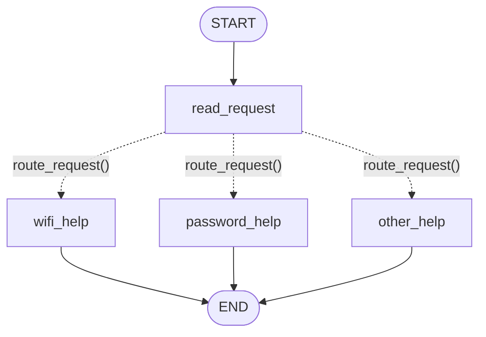
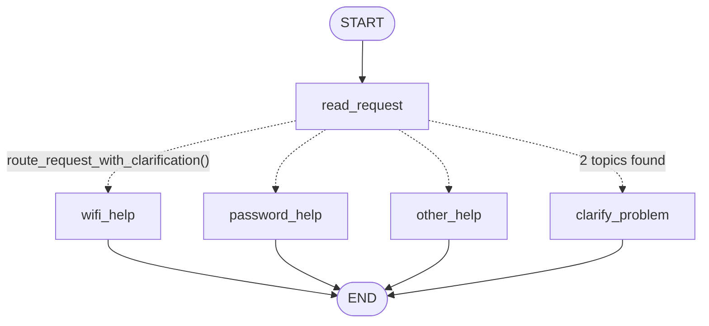
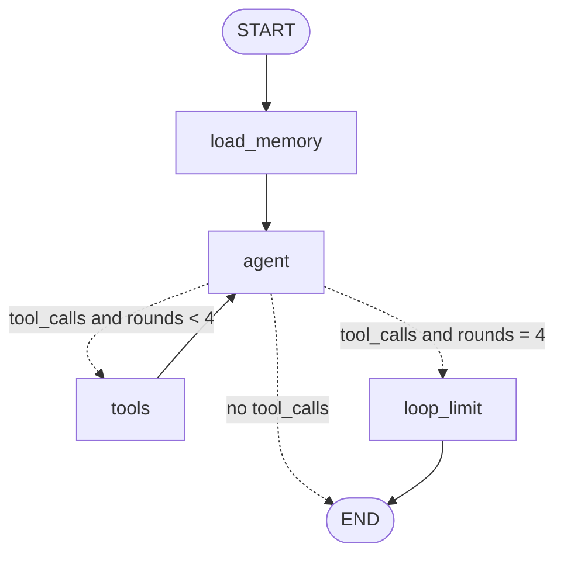

# HW5 — My LangGraph helpdesk

- **Name:** _Amankeldy Abylaj_
- **Repository:** _https://github.com/abylajamankeldy/css4007-hw5.git_
- **Model and provider used for Parts 2–3:** _(fill in after the real run, e.g. `openai/gpt-oss-120b` via Groq, OpenAI-compatible endpoint)_
- **Python:** 3.13. Package versions: `requirements.txt`.

Setup and exact commands: [README.md](README.md). Logs: [outputs/](outputs/).

---

## Part 1 — How the graph works

Code: `helpdesk/part1_graph.py`. No model; every decision is a Python `if`.

### My graph and state



State (`Part1State`, a `TypedDict`):

| Field | Written by | Meaning |
| --- | --- | --- |
| `message` | the input (`app.invoke({"message": ...})`) | the user's original message, never changed |
| `category` | `read_request` | `wifi`, `password` or `other` (first rule that matches) |
| `topics_found` | `read_request` | every topic keyword present, e.g. `["wifi", "password"]` (used by the changed graph) |
| `reply` | one help node | the answer shown to the user |

**1. What does each node read and change?**

| Node | Reads | Changes |
| --- | --- | --- |
| `read_request` | `message` (lower-cased) and the keyword lists `topic_aliases` from `data/helpdesk.json` | `category`, `topics_found` |
| `wifi_help` | `data/helpdesk.json` → `instructions.wifi` | `reply` |
| `password_help` | `data/helpdesk.json` → `instructions.password` | `reply` |
| `other_help` | nothing | `reply` (asks: Wi-Fi or password?) |

**2. Node update vs conditional edge.** A node returns a *dict*, e.g. `{"category": "wifi"}`;
LangGraph merges it into the state. That is **data**. The conditional edge `route_request(state)`
returns a *node name*, e.g. `"wifi_help"`; it does not change the state. That is **control flow**:
it only decides which node runs next.

**3. What does the next node receive?** The **whole current state** after the merge, not only the
previous update. In the S01 trace, `wifi_help` runs with
`{"message": ..., "category": "wifi", "topics_found": [...]}`; `message` came from the input, not
from `read_request`.

**4. START, END, compile.** `START` is the virtual entry: the input dict becomes the first state and
the edge `START → read_request` says which node runs first. `END` is the virtual exit: when a node
leads to `END` the run stops and `invoke()` returns the final state. `graph.compile()` checks the
description (all edges lead to existing nodes, START is connected) and turns it into a runnable
object with `.invoke()` and `.stream()`; a `StateGraph` cannot run before it is compiled.

### Predictions before running

Rules in order: contains `wifi`/`wi-fi` → `wifi_help`; else contains `password` → `password_help`;
else `other_help`. The message is lower-cased first.

| Message | Predicted route | Actual route | What I learned |
| --- | --- | --- | --- |
| I cannot connect to Wi-Fi. | read_request → wifi_help | read_request → wifi_help ([S01](outputs/S01.md)) | `wi-fi` alias matches after lower-casing |
| I forgot my PASSWORD. | read_request → password_help | read_request → password_help ([S02](outputs/S02.md)) | `lower()` makes the rule case-insensitive |
| My laptop screen is broken. | read_request → other_help | read_request → other_help ([S03](outputs/S03.md)) | no rule matches → fallback asks Wi-Fi or password |
| My Wi-Fi password does not work. | read_request → wifi_help | read_request → wifi_help ([S04](outputs/S04.md)) | both topics found, but rule 1 is checked first, so the password part is silently ignored |

All four actual routes matched the predictions. The state after each node is in each log.

**Both topics.** `read_request` finds `["wifi", "password"]` but sets `category = "wifi"` because the
`if "wifi"` rule comes before `elif "password"`. The user gets Wi-Fi steps although the problem may
be the password. The **order of the rules** causes this.

### My change to the graph



`build_part1_graph("with_clarification")` adds the node `clarify_problem` and uses
`route_request_with_clarification`, which first checks `len(topics_found) > 1`. `read_request`
itself is unchanged.

New trace for "My Wi-Fi password does not work." ([S05](outputs/S05.md)):

| step | node | state after node |
| --- | --- | --- |
| 1 | read_request | `category: "wifi"`, `topics_found: ["wifi", "password"]` |
| 2 | clarify_problem | `category: "needs_clarification"`, `reply: "...Is the problem connecting to Wi-Fi, or recovering your account password? Which one should we solve first?"` |

Route: `START → read_request → clarify_problem → END` instead of `→ wifi_help`. A different node
runs, not just a different sentence.

**What LangGraph controls:** running nodes in order, merging each returned update into the state,
calling the routing function after `read_request` and jumping to the node it names, stopping at
`END`, and streaming the steps (`stream_mode="updates"`) for the trace.
**What my functions decide:** the category (`read_request`), the next node (`route_request…`) and
the reply text (help nodes). No model decides anything in Part 1.

---

## Part 2 — Model and tools

Code: `helpdesk/tools.py` (tools), `helpdesk/agent.py` (graph).

### Tools

| Tool | Model gives | Our program adds | Returns |
| --- | --- | --- | --- |
| `find_instructions` | `topic` | — | steps + `instruction_id` from `helpdesk.json` |
| `check_service_status` | `service` | `status_profile` (chosen at start) | `operational` / `outage` / `unknown` + message |
| `prepare_ticket` | `category`, `summary`, `steps_tried` | `user_id`, `thread_id`, `status_profile`, `service_status` (from an earlier status result, else `not_checked`) | writes `outputs/tickets/DRAFT-….json`, or `created: false` + what is missing |
| `remember_preference` (Part 3) | `language` | `user_id`, store | saves the preference |

Each tool is a plain function and works without the agent: `python -m helpdesk.tools`
(output saved in [outputs/tools_direct.txt](outputs/tools_direct.txt)); also `tests/test_tools.py`.
`prepare_ticket` refuses to write a draft without a problem description and steps
(`ticket_policy.unknown_information`) and refuses text that looks like a password.

### The execution loop



1. `agent` sends the system prompt + all messages to the model.
2. The model answers with an `AIMessage`. If it contains `tool_calls` (name + JSON arguments),
   that is a **request**, nothing has run yet.
3. `route_after_agent` sees the request and goes to `tools`.
4. `tools_node` (my Python code) runs each requested function and appends a `ToolMessage` with the
   result.
5. Back to `agent`: the model now sees the result and either requests another tool or answers.

**Loop limit.** `MAX_TOOL_ROUNDS = 4` in `agent.py`. `tools_node` increments `tool_rounds`;
`route_after_agent` sends the run to `loop_limit` instead of `tools` once 4 rounds were used.
`loop_limit` answers the pending calls with "not executed" (the API needs a result for every call)
and ends the turn with an honest message. `tool_rounds` is reset to 0 at the start of every user
message. Second safety net: LangGraph `recursion_limit=25` in `run_turn`.
Tested in `test_loop_limit_stops_endless_tool_requests` with a fake model that always asks for a tool.

**1. How does the graph decide between running a tool and ending?** `route_after_agent` looks at the
last message: no `tool_calls` → `END`; `tool_calls` and fewer than 4 rounds → `tools`; otherwise
`loop_limit`. The function is mine; what it reacts to is produced by the model.

**2. Who requests, who executes?** The **model** only requests: it returns text describing a call.
**`tools_node`** (my code) executes it. The model cannot run code, choose the user or the status
snapshot; those come from the session (`config["configurable"]`).

**3. What changes in the state after a tool result?** `messages` gets a `ToolMessage` appended
(reducer `add_messages`, so nothing is overwritten); `tool_rounds` +1; `service_status_seen`
records the status (e.g. `{"wifi": "operational"}`); `last_ticket_file` if a draft was saved;
`sources` lists what was read. On the next `agent` call the model sees the longer message list.

**4. Difference from Part 1.** In Part 1 the route is fixed by my `if` rules and I can predict it
from the text alone. In Part 2 the graph has the same few edges, but the path (which tools, how
many rounds, whether a ticket is made) is decided at run time by the model's output and by the
tool **results**. The same message gives different paths with different snapshots (S06/S07/S08).

### Actual run with several tools

_(fill in after `python -m helpdesk.run_scenarios`: paste the S06 second turn from
[outputs/S06.md](outputs/S06.md) — model requests, tool results, final answer.)_

### Same request, three snapshots

| Scenario | Snapshot | Tools requested | Ticket? | Reply (short) |
| --- | --- | --- | --- | --- |
| S06 | `normal` | _(fill in)_ | _(fill in)_ | _(fill in)_ |
| S07 | `wifi_outage` | _(fill in)_ | _(fill in)_ | _(fill in)_ |
| S08 | `status_unavailable` | _(fill in)_ | _(fill in)_ | _(fill in)_ |

---

## Part 3 — Memory

Code: `helpdesk/storage.py`, `load_memory` and `remember_preference` in `helpdesk/agent.py`.

**Conversation memory** = the graph state of one thread: all messages (user, model, tool results),
`service_status_seen`, `last_ticket_file`. The checkpointer **`SqliteSaver`** saves it to
`local-storage/conversations.sqlite` after every step, keyed by `thread_id`. When a message
arrives with the same `thread_id`, LangGraph loads the saved state first and appends the new
message, so the model sees the whole conversation — also after the program was closed.
"The current problem" and "steps already tried" are inside these saved messages.

**User memory** = the preference `{"reply_language": "Kazakh"}` in **`SqliteStore`**
(`local-storage/user_memory.sqlite`), namespace `("users", user_id)`, key `preferences`.
It is written only by the `remember_preference` tool (the model decides to call it when the user
asks; the program supplies `user_id`). `load_memory` reads it at the start of every turn and puts
it into the system prompt. Nothing is hard-coded or loaded from `demo_users.json`.

**`thread_id` vs user identifier.** `thread_id` identifies **one conversation** (one checkpoint
history). `user_id` identifies **a person**. One user can have many threads. The checkpointer is
keyed by `thread_id`; the store is keyed by `user_id`. A new thread starts with no messages, but
the same user's preference is still found. Both ids are given on the command line
(`--user`, `--thread`), never chosen by the model.

**Retrieval vs memory.** Looking up Wi-Fi instructions is **retrieval**: the answer comes from a
fixed reference file that is the same for every user, is not changed by the conversation, and is
fetched on demand by topic. Recalling the chosen language is **memory**: the app learned it from
this user's own message, wrote it, and reads it back later; another user has different (or no)
memory.

Every log has a "Sources used in this turn" list that shows what was read from user memory, from
the conversation checkpoint and from the reference files.

| Situation | Command used | Log file | What happened |
| --- | --- | --- | --- |
| Refer to an earlier message | `python -m helpdesk.run_scenarios S10` | [S10](outputs/S10.md) | _(fill in)_ |
| Close, restart and resume | `python -m helpdesk.run_scenarios S11` (second message runs in a new process) | [S11](outputs/S11.md) | _(fill in)_ |
| Same user, new conversation | `python -m helpdesk.run_scenarios S12` | [S12](outputs/S12.md) | _(fill in)_ |
| Different user | `python -m helpdesk.run_scenarios S13` | [S13](outputs/S13.md) | _(fill in)_ |

Manual version of the restart (each line is a separate process):

```bash
python -m helpdesk.cli say --user demo-user-a --thread restart-a "Please remember that I prefer replies in Kazakh. My issue is Wi-Fi. I enabled it and tried reconnecting, but it still fails."
python -m helpdesk.cli say --user demo-user-a --thread restart-a "Which problem and steps did we discuss?"
python -m helpdesk.cli say --user demo-user-a --thread new-thread "Which language did I ask you to use?"
python -m helpdesk.cli say --user demo-user-b --thread b-1 "Have I told you a preferred language or a previous problem?"
```

---

## Part 4 — Running and checking my work

- Install, key, run commands, scenario runner: [README.md](README.md) sections 1–4.
- Versions: `requirements.txt` (pinned), `requirements-lock.txt` (full freeze), Python 3.13.
- Memory location and reset: README section 5 (`python -m helpdesk.cli reset`).
- Tests: `python -m pytest -v` — 30 tests, table in README section 6.
- CI: `.github/workflows/tests.yml`, runs on every push on Ubuntu and Windows.

Which mistake each test catches:

| Test | Catches |
| --- | --- |
| `test_original_graph_routes`, `test_changed_graph_routes` | wrong rule order, case sensitivity, `wi-fi` not matched, missing clarify branch |
| `test_state_after_each_node` | a node overwriting `message`, `reply` set too early |
| `test_status_depends_on_snapshot`, `test_password_topic_maps_to_account_recovery` | ignoring the snapshot, `unknown` treated as working, wrong service for passwords |
| `test_prepare_ticket_*` | missing template fields, a ticket with invented/empty steps, a password in a ticket |
| `test_operational_leads_to_ticket`, `test_outage_leads_to_no_ticket`, `test_unknown_status_asks_user` | the loop not returning to the model, a hard-coded snapshot |
| `test_ticket_records_checked_status_from_program` | the model, not the tool result, deciding the ticket's status / user |
| `test_loop_limit_stops_endless_tool_requests` | an endless model ↔ tools loop |
| `test_conversation_survives_process_restart` | an in-memory checkpointer; state lost when the process ends |
| `test_preference_survives_restart_in_new_thread` | preference saved in the thread instead of user memory |
| `test_users_are_separated`, `test_threads_are_separated` | memory leaking between users or conversations |

**Fake model.** `tests/test_agent_loop.py` and `tests/test_memory.py` use
`helpdesk/fake_model.py`: keyword rules that return the same message types as a real model
(`tool_calls` or text). It is labelled "FAKE" in every output. It tests the graph, the tools and
the storage, not the quality of a model's decisions. The real-model demonstration is run by hand
with `python -m helpdesk.run_scenarios` and is not part of CI.

---

## Choices and limitations

**Storage.** SQLite for both memories: one file each, no server, survives restarts, works on
Windows, and LangGraph provides `SqliteSaver` and `SqliteStore`. Two separate files make the two
kinds of memory visible. Files are under `local-storage/` (git-ignored).

**Model adapter.** `langchain-openai`'s `ChatOpenAI` with an optional `OPENAI_BASE_URL`, so the
same code works with OpenAI or any OpenAI-compatible provider (I used: _(fill in)_).

**Own `tools_node`** instead of the prebuilt `ToolNode`: so the program can add `user_id`,
`thread_id`, `status_profile` and the store, which the model must not choose, and so the place
where tools are executed is visible in my code.

**Limitations.**
- Saving the preference depends on the model calling `remember_preference`; a model could miss it.
- Whether the model obeys "only if operating" depends on the model; the code only guarantees that
  the ticket's `service_status` comes from a real tool result.
- Conversation memory grows without limit (no trimming or summarising, cf. HW2).
- The secret check in tickets is a simple regular expression.
- Reply quality in Kazakh depends on the model.
- _(add anything that went wrong in the real run)_

---

## Supplied scenarios — my actual results

All commands are run from the repository root. Each Part 2–3 scenario resets
`local-storage/scenarios/` first; `restart_process` starts a new Python process.

| Scenario | Command or manual steps | Log file | What happened / what I changed |
| --- | --- | --- | --- |
| S01 — Simple Wi-Fi route | `python -m helpdesk.run_scenarios S01` | [S01](outputs/S01.md) | `read_request → wifi_help`; reply = GUIDE-WIFI steps. As predicted. |
| S02 — Case-insensitive password route | `python -m helpdesk.run_scenarios S02` | [S02](outputs/S02.md) | `read_request → password_help`; `PASSWORD` matched after `lower()`. |
| S03 — Unsupported request | `python -m helpdesk.run_scenarios S03` | [S03](outputs/S03.md) | `read_request → other_help`; asks Wi-Fi or password. |
| S04 — Two topics before the graph change | `python -m helpdesk.run_scenarios S04` | [S04](outputs/S04.md) | original graph: `topics_found=["wifi","password"]` but rule 1 wins → `wifi_help`; password part ignored. |
| S05 — Two topics after adding clarification | `python -m helpdesk.run_scenarios S05` | [S05](outputs/S05.md) | changed graph: `read_request → clarify_problem`; asks which problem first. |
| S06 — Instructions then local ticket | `python -m helpdesk.run_scenarios S06` | [S06](outputs/S06.md) | _(fill in)_ |
| S07 — The same request during a Wi-Fi outage | `python -m helpdesk.run_scenarios S07` | [S07](outputs/S07.md) | _(fill in)_ |
| S08 — Status source unavailable | `python -m helpdesk.run_scenarios S08` | [S08](outputs/S08.md) | _(fill in)_ |
| S09 — Missing ticket details | `python -m helpdesk.run_scenarios S09` | [S09](outputs/S09.md) | _(fill in)_ |
| S10 — Use the current conversation | `python -m helpdesk.run_scenarios S10` | [S10](outputs/S10.md) | _(fill in)_ |
| S11 — Persist and recall after restart | `python -m helpdesk.run_scenarios S11` | [S11](outputs/S11.md) | _(fill in)_ |
| S12 — Preference across threads without replay | `python -m helpdesk.run_scenarios S12` | [S12](outputs/S12.md) | _(fill in)_ |
| S13 — Do not share memory between users | `python -m helpdesk.run_scenarios S13` | [S13](outputs/S13.md) | _(fill in)_ |
| S14 — Password recovery outage | `python -m helpdesk.run_scenarios S14` | [S14](outputs/S14.md) | _(fill in)_ |

---

## AI tool disclosure

The code, tests and first drafts of the explanations were written with Claude (Anthropic).
I ran the program, the tests and the real-model scenarios myself, checked the logs and edited the
answers to match my own runs. _(edit if needed)_
